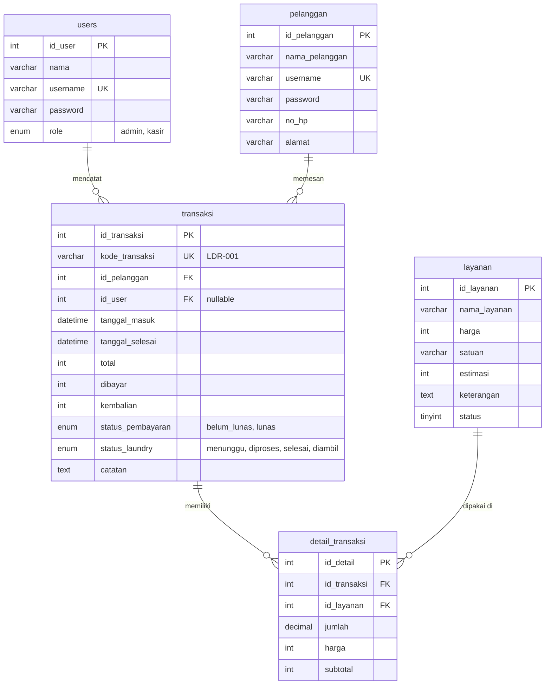
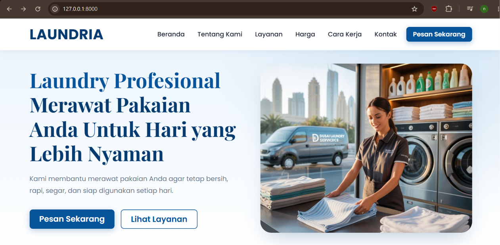
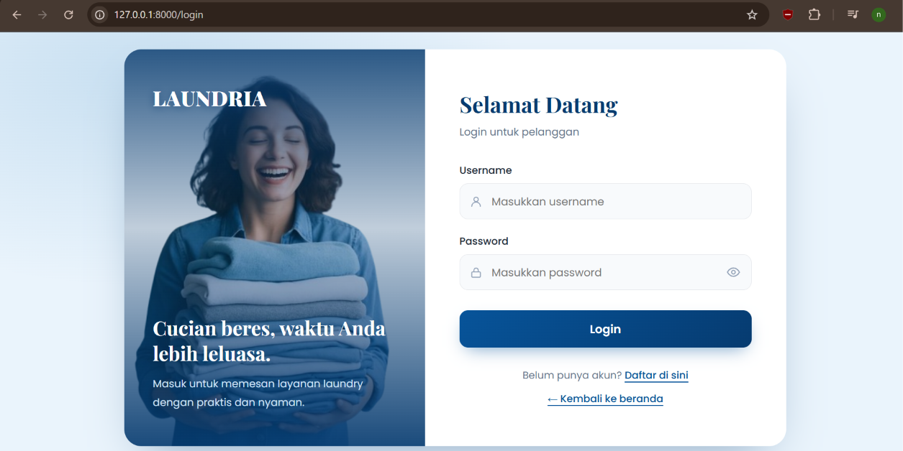
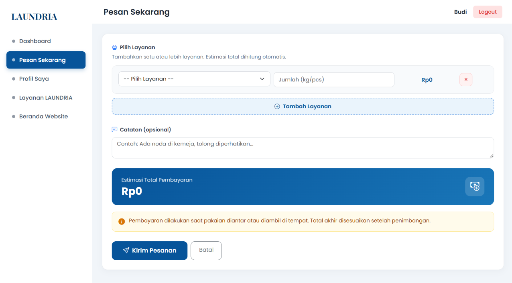
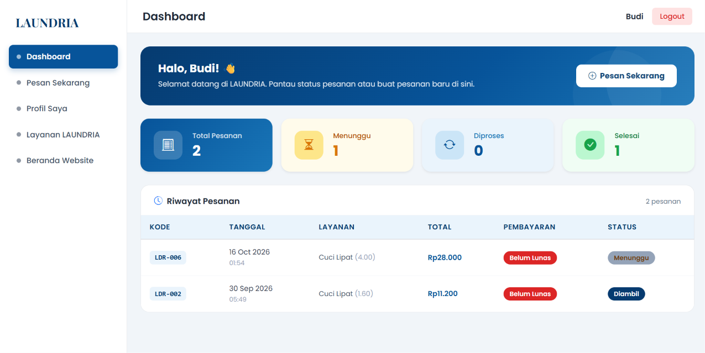
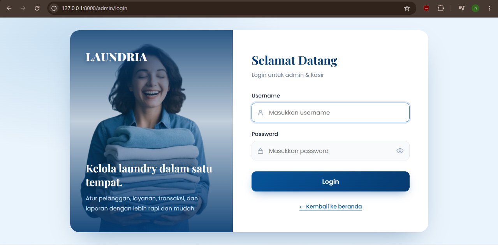
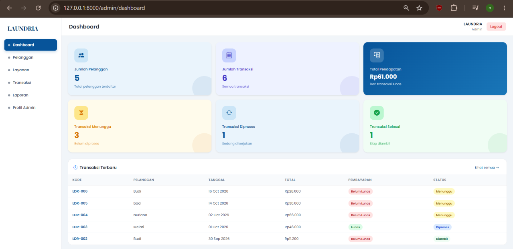
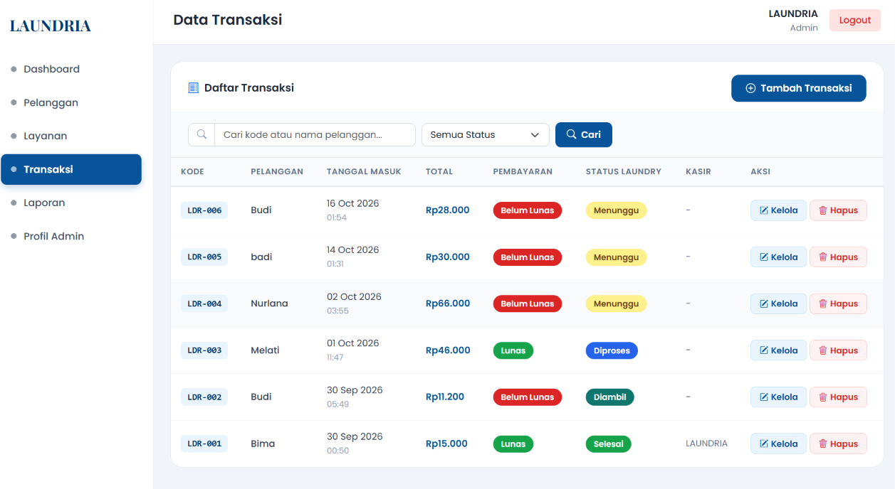
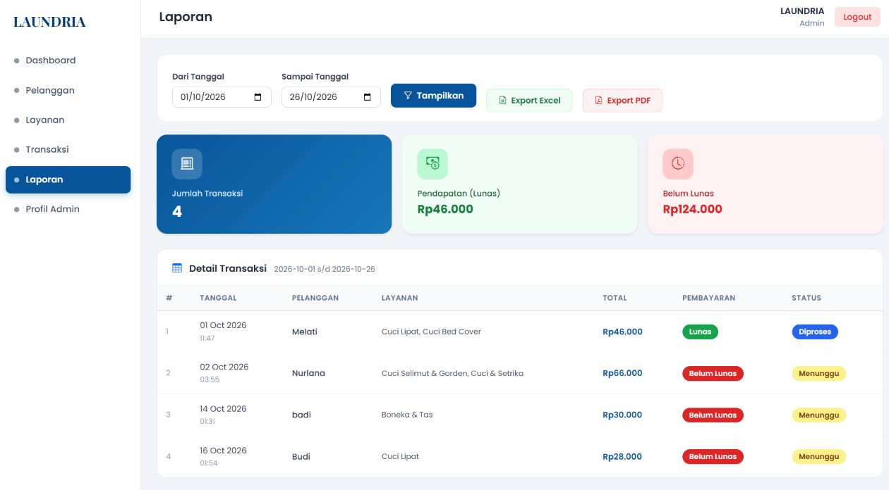

# LAUNDRIA — Sistem Laundry 

Aplikasi web untuk mengelola layanan laundry: pelanggan dapat melihat layanan, harga, dan estimasi lalu memesan secara online, sedangkan admin mengelola pelanggan, layanan, transaksi, dan laporan. Dibangun dengan Laravel, MySQL, dan Bootstrap 5.

Dibuat oleh: **Nur Lana Agustin** — **XII RPL, SMKN 6 SURAKARTA**

## Fitur

### Admin
- Login & logout dengan proteksi session
- Dashboard: ringkasan jumlah pelanggan, transaksi, pendapatan, dan status laundry
- Kelola data pelanggan (tambah, edit, hapus) + pencarian & pagination
- Kelola layanan dan harga (tambah, edit, hapus, aktif/nonaktif) + pencarian & pagination
- Input transaksi dengan banyak layanan, total dan kembalian dihitung otomatis
- Kode pesanan otomatis dan berurutan (`LDR-001`, `LDR-002`, ...) pada setiap transaksi
- Kelola status laundry (Menunggu, Diproses, Selesai, Diambil) dan status pembayaran — "Lunas" ditolak jika pembayaran kurang
- Filter transaksi berdasarkan status, cari berdasarkan kode pesanan atau nama pelanggan
- Laporan per rentang tanggal: rekap pendapatan, export **Excel** dan **PDF**
- Profil admin (ubah nama, username, password)

### Pelanggan
- Register & login akun pelanggan
- Landing page: layanan, harga, estimasi, cara kerja, dan kontak (data dari database)
- Pesan Sekarang: pilih lebih dari satu layanan, estimasi total dihitung otomatis
- Kode pesanan ditampilkan setelah memesan (contoh: `LDR-008`)
- Dashboard riwayat pesanan beserta kode pesanan, status bayar, dan status laundry
- Edit profil dan ganti password

Tampilan responsif untuk HP, dan landing page menampilkan status "Buka/Tutup sekarang" otomatis.

## Tech Stack

| Komponen | Teknologi |
|---|---|
| Backend | Laravel 13, PHP 8.3 (Eloquent ORM, Migration, Seeder) |
| Database | MySQL |
| Frontend | Blade + Bootstrap 5 |
| Export | maatwebsite/excel, barryvdh/laravel-dompdf |
| Dev | Laragon + VS Code |

## Cara Instalasi (Laragon)

Kebutuhan: PHP 8.2+ (ekstensi `gd` dan `zip` aktif), Composer, MySQL.

1. Clone repo ke folder `www`:
```bash
cd C:\laragon\www
git clone https://github.com/nurlanaaaaa3/Laundry-LANARIA.git laundria
cd laundria
```

2. Install dependency:
```bash
composer install
```

3. Salin file konfigurasi dan buat app key:
```bash
copy .env.example .env
php artisan key:generate
```

4. Buat database kosong bernama `laundria` lewat phpMyAdmin atau HeidiSQL.

5. Sesuaikan `.env`:
```env
DB_CONNECTION=mysql
DB_HOST=127.0.0.1
DB_PORT=3306
DB_DATABASE=laundria
DB_USERNAME=root
DB_PASSWORD=
```

6. Buat tabel dan isi data awal (layanan, akun admin, akun pelanggan demo):
```bash
php artisan migrate --seed
```

7. Jalankan aplikasi:
```bash
php artisan serve
```
Akses aplikasi di `http://127.0.0.1:8000`.

## Akun Demo

| Role | Alamat Login | Username | Password |
|---|---|---|---|
| Admin | `/admin/login` | `admin` | `admin123` |
| Pelanggan | `/login` | `pelanggan` | `pelanggan123` |

## Struktur Folder

```
laundria/
├── app/
│   ├── Exports/               # Export Excel laporan
│   ├── Http/Controllers/
│   │   ├── Admin/             # Dashboard, Pelanggan, Layanan, Transaksi, Laporan, Profile
│   │   ├── Auth/              # Login admin & login/register pelanggan
│   │   ├── Pelanggan/         # Profil pelanggan
│   │   ├── BookingController.php
│   │   └── LandingController.php
│   └── Models/                # User, Pelanggan, Layanan, Transaksi, DetailTransaksi
├── database/
│   ├── migrations/            # Struktur tabel
│   └── seeders/               # Data awal layanan, admin, dan pelanggan demo
├── docs/                      # Screenshot untuk README
├── public/                    # CSS, JS, gambar
├── resources/views/
│   ├── admin/                 # Halaman admin
│   ├── auth/                  # Login & register
│   ├── landing/               # Landing page
│   └── pelanggan/             # Halaman pelanggan
├── routes/web.php
└── README.md
```

## ERD



Catatan: `harga` di `detail_transaksi` menyimpan harga saat transaksi dibuat, sehingga perubahan harga layanan tidak mengubah transaksi lama. Pesanan dari pelanggan memiliki `id_user` kosong karena dibuat sendiri oleh pelanggan. `kode_transaksi` unik dan terisi otomatis oleh model `Transaksi`, dengan nomor berikutnya dihitung dari angka terbesar yang sudah ada.

## Screenshot

### Pelanggan

| Landing Page | Login Pelanggan |
|---|---|
|  |  |

| Pesan Sekarang | Dashboard Pelanggan |
|---|---|
|  |  |

### Admin

| Login Admin | Dashboard Admin |
|---|---|
|  |  |

| Transaksi | Laporan |
|---|---|
|  |  |

### Tampilan HP

| Landing Page di HP | Dashboard Admin di HP |
|---|---|
|  |  |

| Dashboard Pelanggan di HP | Pesan Sekarang di HP |
|---|---|
|  |  |

## Keamanan

Password di-hash dengan bcrypt, query memakai Eloquent ORM (prepared statement), validasi input di setiap form, perlindungan CSRF, serta guard login terpisah untuk admin dan pelanggan.

## Catatan Deploy

Project ini dijalankan secara lokal (Laragon/XAMPP). Jika ingin online, hosting harus mendukung PHP 8.2+, MySQL, dan Composer, serta document root diarahkan ke folder `public/`.


## Naskah Video Demo (2–3 menit)

**[0:00 – 0:15] Opening**

"Halo, perkenalkan saya Nur Lana Agustin, siswa XII RPL dari SMKN 6 Surakarta. Saya akan mendemonstrasikan LAUNDRIA, sistem laundry online yang saya bangun menggunakan Laravel, MySQL, dan Bootstrap 5."

**[0:15 – 0:40] Landing Page**

"Ini landing page yang bisa dilihat tanpa login. Ada profil LAUNDRIA, daftar layanan, daftar harga, cara kerja, dan kontak. Data layanan dan harga diambil langsung dari database, jadi otomatis berubah saat admin mengeditnya."

**[0:40 – 1:10] Pelanggan: Register & Pesan**

"Pelanggan klik Pesan Sekarang, lalu mendaftar akun. Setelah masuk, pelanggan memilih layanan dan jumlahnya, dan sistem menghitung estimasi total otomatis. Setelah dikirim, pelanggan mendapat kode pesanan, misalnya LDR-008, dan pesanan muncul di riwayat dengan status Menunggu."

**[1:10 – 1:40] Admin: Dashboard & Kelola Data**

"Sekarang saya login sebagai admin. Dashboard menampilkan jumlah pelanggan, transaksi, pendapatan, dan status laundry. Di menu Pelanggan dan Layanan, admin bisa menambah, mengedit, menghapus, serta mencari data."

**[1:40 – 2:15] Admin: Transaksi**

"Di menu Transaksi, pesanan dari pelanggan tadi sudah masuk dengan kode pesanan yang sama, dan admin bisa mencarinya lewat kotak cari. Lewat tombol Kelola, admin mengubah status laundry dari Menunggu sampai Diambil, dan mengubah status pembayaran. Sistem menolak status Lunas jika pembayaran kurang dari total."

**[2:15 – 2:40] Laporan**

"Di menu Laporan, admin memilih rentang tanggal untuk melihat rekap transaksi dan pendapatan, lalu mengekspornya ke Excel atau PDF."

**[2:40 – 3:00] Closing**

"Demikian demo singkat LAUNDRIA. Sistem ini menerapkan password hashing, Eloquent ORM yang memakai prepared statement, validasi input, token CSRF, dan guard login terpisah untuk admin dan pelanggan. Terima kasih."

---
Dibuat untuk project UKK RPL - SMKN 6 SURAKARTA
